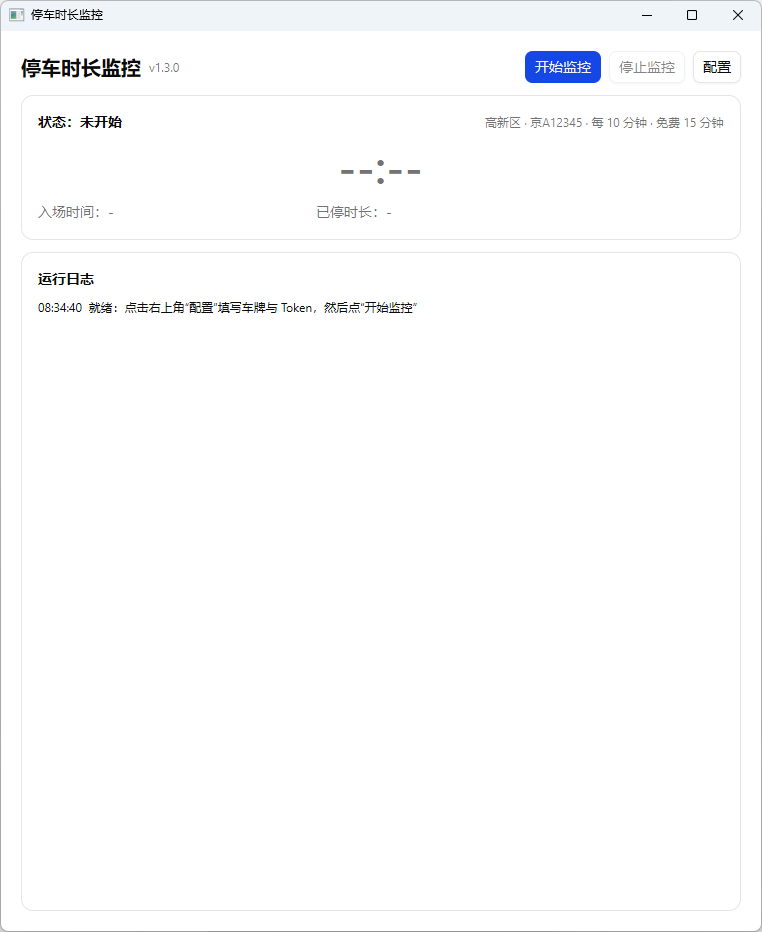
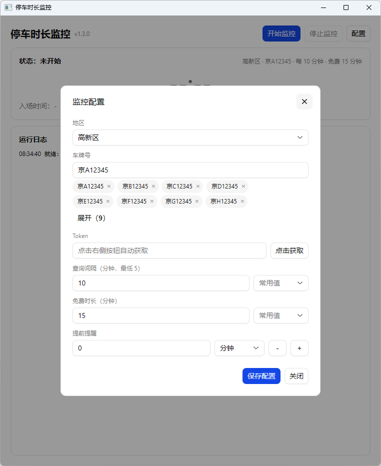

# 停车免费时长监控（ParkingMonitor）

> 仅适用于西安市高新区、莲湖区、碑林区的路侧停车位，其他城市或停车场不适用。

一个 Windows 桌面小工具：按设定间隔查询车辆在停状态，在免费时长结束前弹出提醒（弹窗 + 提示音 + 系统通知），方便及时挪车或缴费。



## 功能

- 支持西安市三个区：高新区、莲湖区、碑林区，按地区调用对应停车平台接口
- 绑定车牌，查询间隔最低 5 分钟，可自定义
- 免费时长可配置（默认 15 分钟），支持“提前提醒”（分钟/秒，不能大于免费时长）
- 入场提醒、免费时长倒计时、到期或提前提醒（同一笔停车只提醒一次）
- 提醒弹窗中的“已缴费”：视为车辆出场并重置监控状态
- Token 自动获取（本地代理 + 本地根证书，仅解密所选地区域名流量）
- 运行日志可滚动查看；监控期间阻止电脑睡眠

## 配置界面



## 运行环境

- Windows 10 / 11，64 位
- 无需安装 Go、.NET、VC++ 等运行库
- 能正常访问所选地区的停车小程序（西高新智慧停车 / 莲湖智慧停车 / 碑林智慧停车）

## 使用

1. 解压 `ParkingMonitor.zip`，双击 `ParkingMonitor.exe`。
2. 点右上角“配置”：选择地区、填写车牌；点“点击获取”，然后在对应地区微信小程序里查询一次缴费，程序会自动捕获 Token。
3. 设置查询间隔、免费时长、提前提醒，保存后关闭弹窗。
4. 点主界面右上角“开始监控”；监控中可随时“停止监控”。

> 本工具只查询停车信息，不发起缴费、不修改账号数据。

## 配置与数据

- 配置文件：`%APPDATA%\ParkingMonitor\config.json`
- Token 以明文仅保存在本机，请勿外传该文件
- 首次“点击获取”会安装仅用于本地解密的根证书 `ParkingMonitor Local CA`，可用以下命令卸载：

```
certutil -delstore -user Root "ParkingMonitor Local CA"
```

## 从源码构建

需要 Go 1.26+，Windows 构建无需 CGO：

```
go build -ldflags "-H windowsgui" -o dist/ParkingMonitor.exe .
```

## 免责声明

非官方工具，仅供个人停车提醒使用。接口由第三方停车平台提供，可能随其升级而变化；使用产生的后果由使用者自行承担。
